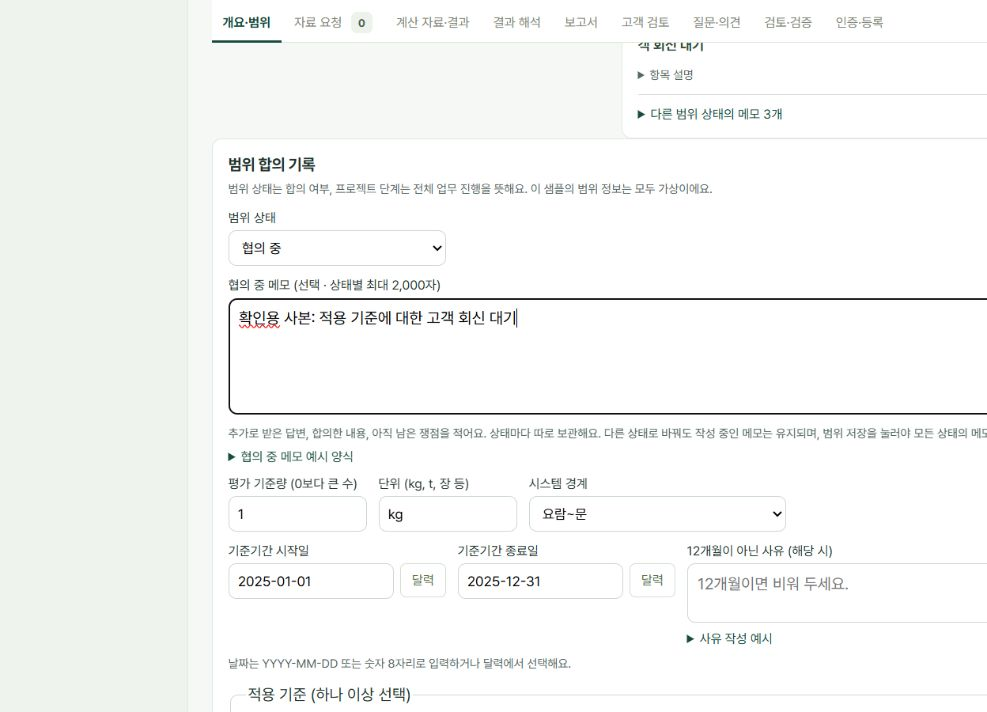

# WEB-070 범위 상태별 메모

작업일: 2026-10-22 (한국 시간).

## 문제와 사용자 결정

기존에는 범위 상태를 고객 요청안에서 협의 중으로 바꿔도 같은 메모 한 칸이 보여 처음 받은 요청과 추가 협의 내용을 구분하기 어려웠다. 사용자는 안내 문구만 바꾸는 방식 대신 **상태별 메모를 따로 보관하고 상태를 바꾸면 해당 메모를 보여주는 방식**을 선택했다. 이번 요청에 한해 기능 추가 중단 결정을 해제하며 다른 기능은 시작하지 않는다.

## 화면과 저장 동작

| 범위 상태 | 적을 내용의 예 |
| --- | --- |
| 미정 | 처음 받은 문의·아직 모르는 내용·먼저 확인할 질문 |
| 고객 요청안 | 고객이 처음 요청한 제품·평가 범위와 추가 확인 사항 |
| 협의 중 | 추가 회신·합의한 내용·남은 쟁점·다음 확인 사항 |
| 확정 | 최종 합의한 범위·기준과 확인 근거 |

- 상태마다 선택 입력 메모를 최대 2,000자씩 보관한다. 상태를 선택하면 해당 메모의 제목·내용·안내·접힌 예시가 바뀐다.
- 상태를 오가며 작성하는 동안 네 메모를 폼 안에 유지한다. 상태 선택만으로 저장하거나 프로젝트 단계를 이동하지 않는다.
- **범위 저장** 한 번으로 선택 상태와 네 상태의 메모를 함께 저장한다. 실패하면 입력을 남기고 오류를 표시한다. 새로고침·다른 프로젝트 열기 전에는 저장해야 한다.
- 기존의 **빈 메모에 항목 넣기**는 현재 선택 상태의 빈 칸에만 해당 양식을 넣는다. 이미 내용이 있으면 비활성화한다. 예시는 가상이며 기준량·기간·적용 기준 등 다른 입력을 자동으로 채우지 않는다.
- 상세 요약에는 저장된 현재 상태의 메모를 보여준다. 다른 상태에 내용이 있으면 접힌 **다른 범위 상태의 메모 N개**에서 조회한다. 단계를 바꾸지 않고 이전 요청을 읽을 수 있다.
- 계약·범위 정의에서만 수정한다. 수집 이후의 범위 수정 제한과 별도의 데이터 수집 시작 조건은 유지한다.

## 기존 기록과 백업

저장 키 `ecoable-lca-manager.scope.v1`과 저장 형식 version 1을 유지하고, 범위 기록에 선택 필드 `scopeMemos`를 추가한다.

```json
{
  "scopeStatus": "협의 중",
  "scopeMemo": "추가 회신과 남은 협의 내용",
  "scopeMemos": {
    "미정": "",
    "고객 요청안": "처음 받은 요청",
    "협의 중": "추가 회신과 남은 협의 내용",
    "확정": ""
  }
}
```

`scopeMemo`는 현재 저장 상태의 메모와 같은 값으로 유지한다. 기존 한 칸 메모만 있는 기록은 **당시 저장된 범위 상태에만** 연결하고 다른 상태는 비워 읽는다. 읽기만으로 저장소를 다시 쓰지 않는다. 이전 형식의 저장 호출도 다른 상태의 기존 메모를 보존한다.

새 필드가 있으면 네 상태 키·문자열·상태별 길이·현재 메모와의 일치를 검사한다. 범위 스냅샷에도 네 메모를 포함하여 다른 화면에서 메모가 바뀌면 기존 충돌 비교가 감지한다. 담당자 변경과 단계 이동은 기존 범위 기록을 펼쳐 보관하는 경로를 유지한다.

전체 JSON 백업은 원래 저장 문자열을 보관하고 범위 저장소 검사를 재사용하므로 새 필드도 포함한다. 기존 백업도 새 화면에서 읽는다. 이 변경은 상태마다 최신 메모 한 개를 보관하는 기능이며, 수정할 때마다 시각·버전을 쌓는 변경 이력은 아니다.

## 확인한 범위

자동 테스트 묶음은 사용자 방침에 따라 실행하지 않았다. 변경 JS 세 파일의 구문 검사와 격리된 로컬 주소의 브라우저 조작을 확인했다.

- 기존 `handoff/latest-backup.json`을 로컬 사본에 복원하고 기존 225자 메모가 고객 요청안에 그대로 보이는 것을 확인했다.
- 네 상태를 오가며 별도 메모를 입력하고, 저장 전에도 처음 내용과 각 상태의 입력이 유지됨을 확인했다.
- 협의 중을 선택한 채 범위 저장 후 새로고침하여 네 메모가 모두 유지되고 단계는 범위 정의인 것을 확인했다.
- 새 JSON 백업을 내려받고 로컬 사본에 다시 복원·새로고침하여 네 메모가 모두 원래 값과 같은 것을 확인했다.
- 상세 요약의 현재 메모와 다른 상태 메모 3개 펼침 항목을 확인했다.

저장 용량 초과·동시 창 충돌·수집 이후 조회·모바일 전체 흐름·기존 전체 기능 시험은 실행하지 않았다. 로컬 확인용 한빛포장 사본의 저장을 실제 공개 사이트 롤플레이 R08 완료로 세지 않는다. 실제 사용자 탭의 입력 사본을 먼저 보관했고 실제 업무 메모·상태는 대신 저장하지 않는다.

확인 근거: [수동 브라우저 확인 요약](evidence/WEB-070/manual-browser-check.json).



## 공개 반영

같은 public Site `appgprj_6ad72e6be4dc8191bdc6b088fc884519`에 반영한다. 앱의 web 자산만 배포하고 handoff 백업·개인 실습 기록·QA 다운로드는 배포하지 않는다. 배포 결과와 실제 사용자 화면 확인은 아래에 추가한다.

공개 주소: https://lca-project-manager-kina2002.flowy-pony-5289.chatgpt.site/

### 반영 완료 결과

- Sites 공개 버전 **2**, 배포 `appgdep_6ad963a572488191b7f3282fa4de11a6`의 **succeeded**를 확인했다(2026-10-22).
- 앱 구현 GitHub 커밋: `5eb1ae0eeda2f0c856d989a49bfdebb766d73dce`.
- Sites 소스 커밋: `229482d04f57297d6e3132cecccf9fc996db1430`.
- 저장 버전: `appgprj_6ad72e6be4dc8191bdc6b088fc884519~appgver_7b421c255c4881918ab3b02a7ec43386`.
- 공식 소스 도구로 정적 자산을 패키징하고 위 커밋과 아카이브로 저장·배포했다. 공개 범위는 public을 유지했고 업무 백업·실습 기록은 아카이브에서 제외했다.
- 공개 새 화면의 고객 요청안 전용 제목을 확인했다. 사용 중인 탭의 18개 입력과 새 화면의 입력 차이가 0개임을 확인한 뒤 원래 탭을 새로고침했다. 다시 연 실제 18개 값도 같았다. 실제 실습의 상태·메모는 저장하지 않았다.
- 공개 화면 근거는 handoff 실습기록 18절과 `evidence/2026-10-22-WEB-070-live.json`이다. 로컬 확인용 서버와 임시 탭은 작업 후 정리한다.

## 면접에서 설명하기

“고객의 최초 요청과 협의 중 추가 답변이 같은 메모에 섞이는 불편을 실습에서 발견했습니다. 범위 상태를 키로 써서 메모 네 개를 구분하고, 선택한 상태의 메모만 편집하도록 바꿨습니다. 이전 메모는 당시 상태에 연결해 보존하고, 저장 전 상태 전환과 새로고침·백업 복원 후 내용 유지도 확인했습니다.”
