# LCA 프로젝트 관리 프로그램 — 한빛포장 롤플레이 실습 기록

기록 버전: **0.1 / 진행 중**

기록일: **2026-10-20, 한국 시간 기준**

프로젝트: **한빛 포장 연습 / LCA-2026-009**

기능 기준: **WEB-068**, 공개 배포 문서 **WEB-069**

## 0. 이 기록을 읽는 방법

이 문서는 LCA 업무를 배우기 위해 만든 프로그램에서 가상 고객과 담당 연구원 역할을 나누어 진행한 학습 기록이다. 고객사·제품·메일은 연습 상황이다. 실제 고객 업무 수행, 인증 취득, 표준 적합성 검증을 완료했다는 뜻으로 사용하지 않는다.

사용자는 앱을 직접 조작하며 배우고, 어시스턴트는 고객사 역할과 입력 이유 설명을 맡는다. 화면에서 확인한 사실, 대화로만 확인한 과거 진행, 다음에 하도록 안내한 일을 구분한다.

| 표시 | 뜻 |
| --- | --- |
| 화면 확인 | 이번 기록 작업에서 실제 브라우저 화면이나 화면 입력값을 읽음 |
| 보관 자료 확인 | 기존 캡처·내려받은 백업·저장된 변경 이력으로 확인함 |
| 대화 요약 | 이전 대화의 내용을 정리함. 당시 클릭·저장 순간의 캡처는 없음 |
| 안내 / 미완료 | 다음에 수행할 일로 제안했으며 완료로 기록하지 않음 |

캡처가 없는 과거 장면을 재연해서 당시 화면으로 표시하지 않았다. 현재 화면을 촬영한 이미지는 현재 상태의 근거로만 사용한다. 최초 문의·등록 안내 등 원문을 그대로 확인할 수 없는 부분은 메일 원문을 새로 지어내지 않고 요약했다. 반복해서 전달한 동일한 추가 회신은 한 사건으로 통합했다.

원본 이미지는 `images/`, 화면에서 읽은 텍스트·입력값과 캡처 출처는 `evidence/`에 보관한다. 그림 번호와 상대경로를 유지한다. 사용자가 2026-10-20 다른 노트북에서 받도록 백업도 GitHub에 올려 달라고 명시하여, 이 가상 실습 기록을 비공개 저장소의 handoff/roleplay/hanbit-LCA-2026-009에 함께 보관한다. 공개 데모의 배포 파일은 아니다.

### 대화에서 진행한 순서

가상 문의·프로젝트 등록 → 초기 담당자 배정·범위 정의 시작 → 범위 입력 검토·적용 기준 설명 → 담당자를 박기나로 변경 → 메모 양식/입력 배치 개선·노트북 이동 준비 → 공개 사이트에서 백업 복원 → 추가 고객 회신과 협의 중 저장 안내 순으로 이어졌다. 아래 R01~R07은 설명을 읽기 쉽게 주제별로 묶은 번호다. 담당자 변경 절에는 초기 배정과 이후 교체를 함께 적었으며, 변경 시점은 실제 저장 이력의 시각을 기준으로 읽는다.

## 1. 실습 목표와 역할

### 무엇을 배우려는가

고객이 보낸 요청을 읽고, 프로젝트에 등록하고, 평가할 제품·기준량·범위·기간을 정리한다. 고객에게 더 확인할 내용과 이미 확인된 내용을 구분하고, 합의 상태에 맞게 다음 단계로 진행하는 연습이다. 이번 기록 시점에는 자료 수집이나 탄소배출량 계산까지 진행하지 않았다.

### 누가 무엇을 맡는가

| 역할 | 이름 | 이번 실습에서 하는 일 |
| --- | --- | --- |
| 가상 고객사 담당자 | 한빛포장 영업팀 김민지 | 요청과 협의 답변 전달, 고객사 내부 부서의 자료 취합 창구 |
| 사용자 / 현재 담당 연구원 | 박기나, RSR-004 | 요청 해석, 범위 기록, 적용 기준 검토·제안, 다음 단계 준비 |
| 초기 프로젝트 담당 연구원 | 김하늘, RSR-001 | 초기 배정 이름. 이후 저장된 변경 이력에서 박기나로 교체됨 |
| 어시스턴트 | 고객사 역할 및 학습 안내 | 가상 회신 작성, 입력 이유 설명, 사용자 진행에 따른 기록·캡처 |

고객 담당자와 담당 연구원은 서로 다른 쪽의 역할이다. 김민지는 고객사 내부에서 생산·구매·설비 등의 자료를 취합할 창구이며, 박기나는 평가 업무를 맡는 연구원이다. 자료별로 필요한 내부 부서를 파악하더라도 이번 실습의 자료 요청 창구는 고객사 담당자다.

## 2. 현재 상태 한눈에 보기

다음 표는 기록 시점의 공개 사이트 화면과 입력값에서 확인한 값이다.

| 항목 | 확인한 값 | 확인 상태 |
| --- | --- | --- |
| 프로젝트 번호 | LCA-2026-009 | 화면 확인 |
| 프로젝트 이름 | 한빛 포장 연습 | 화면 확인 |
| 제품 | 종이 포장 상자 | 화면 확인 |
| 메모의 대상 제품 | A형 1종, HB-BOX-01 | 입력값 확인 |
| 대상 사업장 | 제1공장 | 메모 입력값 확인 |
| 고객 담당자 | 김민지 | 화면 확인 |
| 담당 연구원 | 박기나 / RSR-004 | 화면·변경 이력 확인 |
| 목표 완료일 | 2026-11-30 | 화면 확인 |
| 업무 목적 | 고객사 요구 대응 | 화면 확인 |
| 현재 단계 | 범위 정의 / 2단계 | 화면 확인 |
| 범위 상태 | 고객 요청안 | 화면 확인 |
| 평가 기준량 | 1 kg | 화면 확인 |
| 시스템 경계 | 요람~문 | 화면 확인 |
| 자료 기준기간 | 2025-01-01 ~ 2025-12-31 | 화면 확인 |
| 12개월이 아닌 사유 | 빈칸 | 입력값 확인 |
| 적용 기준 체크 | ISO 14040/44만 선택 | 입력값 확인 |
| 자료 요청 수 | 0건 | 화면 확인 |
| 추가 회신을 메모에 반영 | 아직 안 됨 | 현재 메모와 안내 문구 대조 |
| 범위 상태를 협의 중으로 저장 | 아직 안 됨 | 현재 선택은 고객 요청안 |

**현재 체크된 기준과 고객이 합의한 기준은 구분한다.** ISO 14040/44를 선택해 저장한 사실은 확인했지만, 적용 기준과 거래처 제출 양식의 최종 합의를 마쳤다고 기록하지 않는다.

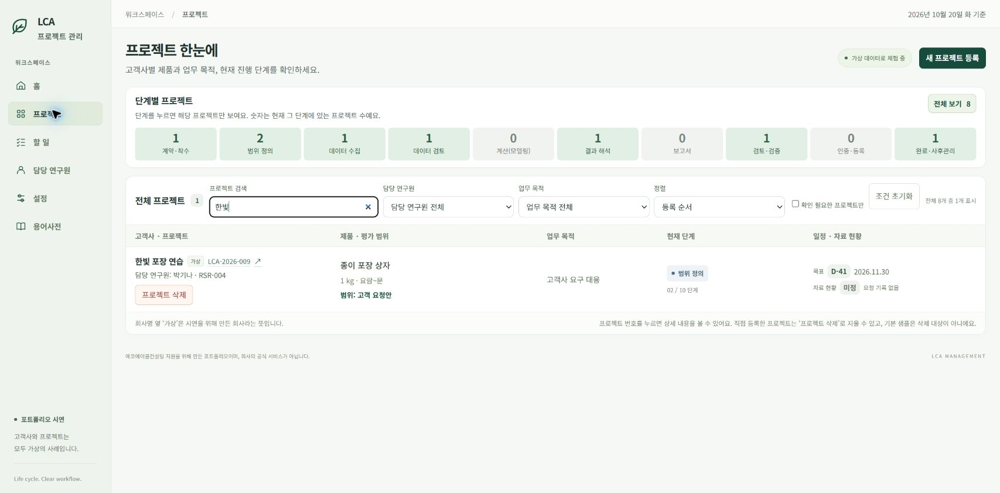

그림 1은 한빛을 검색하여 해당 프로젝트의 한 줄 정보를 촬영한 화면이다. 촬영 후 검색어는 원래의 빈 상태로 돌렸다. 프로젝트 등록 버튼을 누른 당시의 화면은 아니다.

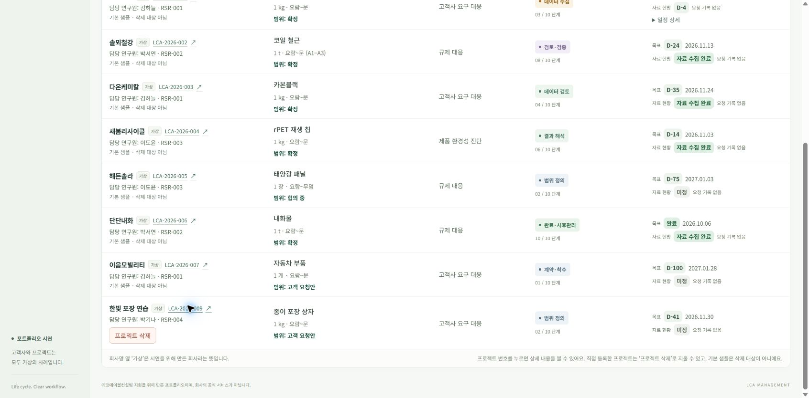

## 3. R01 — 고객 문의를 받고 프로젝트를 등록함

**진행 근거: 대화 요약 + 현재 등록된 프로젝트 확인.** 최초 등록 클릭 순간의 캡처는 보관되어 있지 않다.

### 고객이 요청한 내용

초기 상황은 고객이 거래처에 제출할 제품 탄소정보를 필요로 하고, 연구원에게 평가를 의뢰하는 것이었다. 대화에서 정리한 핵심은 다음과 같다.

- 대상은 종이 포장 상자 A형 1종(HB-BOX-01), 제1공장이다.
- 고객은 제품 1kg당 탄소배출량과 그 산정 근거를 알고 싶어 한다.
- 희망 완료일은 2026-11-30이다.
- 원료·생산·에너지 등의 기록은 고객사 내부 확인 후 제공하는 상황이다.
- 거래처가 지정한 평가 기준과 제출 양식은 처음에는 추가 확인이 필요한 상태였다.

### 앱에 남긴 내용과 이유

회사/프로젝트 이름은 한빛 포장 연습, 제품명은 종이 포장 상자로 등록했다. 업무 목적은 고객사 요구 대응으로 두었다. 이 값은 거래처 요구에 응답하기 위해 평가를 시작한다는 이번 상황을 표현한다. 목표일은 고객이 원하는 전체 업무 완료 시점이며, 자료 수집 마감일과는 별도의 일정이다.

등록 후에는 고객 담당자와 연구원을 연결하고 범위 정의로 진행했다. 고객의 요청을 등록한 것만으로 평가 범위가 합의되거나 자료가 수집된 것은 아니므로, 단계와 합의 상태를 나눠서 관리한다.

### 배운 점

프로젝트를 만든다는 것은 업무의 기본 틀을 만드는 일이다. 이 시점에는 제품의 세부 모델, 평가할 양, 포함할 과정, 자료 기간, 적용 기준을 더 정리해야 한다.

## 4. R02 — 담당자를 정하고 범위 정의로 이동함

**진행 근거: 대화 요약 + 현재 담당자·저장된 변경 이력.**

초기에는 고객 담당자 김민지와 담당 연구원 김하늘을 연결해 실습을 시작했다. 이후 사용자가 담당 연구원을 바꾸고 싶다고 요청했다. 기존 앱은 계약·착수 단계에서만 배정할 수 있어, 범위 정의 단계에서 변경할 메뉴가 없었다.

이 불편을 계기로 WEB-067에서 진행 중 담당 연구원 변경과 전후 이력을 추가했다. 사용자가 직접 저장한 이력은 다음과 같다.

| 항목 | 실제 저장 이력 |
| --- | --- |
| 변경 전 | 김하늘 / RSR-001 |
| 변경 후 | 박기나 / RSR-004 |
| 저장 시각 | 2026-10-19 오후 11:54, 한국 시간 |
| 당시 단계 | 2단계, 범위 정의 |
| 사유 | 연습용 |

사유는 실제 화면의 **연습용** 그대로 기록했다. 인사 이동 등 다른 사유로 바꾸어 설명하지 않는다. 이번 기록 작업에서는 변경 창과 이력을 열어 읽기만 했고 새 변경을 저장하지 않았다.

### 이력이 필요한 이유

현재 담당자를 확인하고, 이후 누가 맡았는지 바뀐 과정을 되짚을 수 있기 때문이다. 과거 보고서에 기록된 담당자 이름까지 지금 이름으로 덮어쓰면 당시 작성 맥락이 사라지므로, 과거 사본은 보존한다.

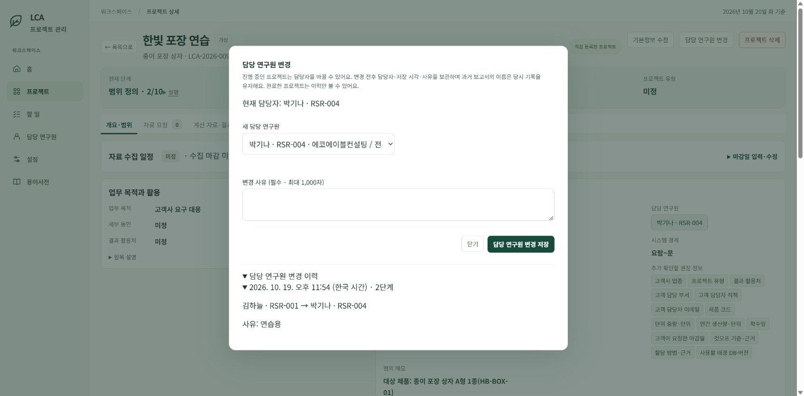

## 5. R03 — 고객 요청을 평가 범위의 항목으로 나눔

**진행 근거: 사용자가 첨부한 초기 입력 화면 + 현재 입력값 + 설명 대화.**

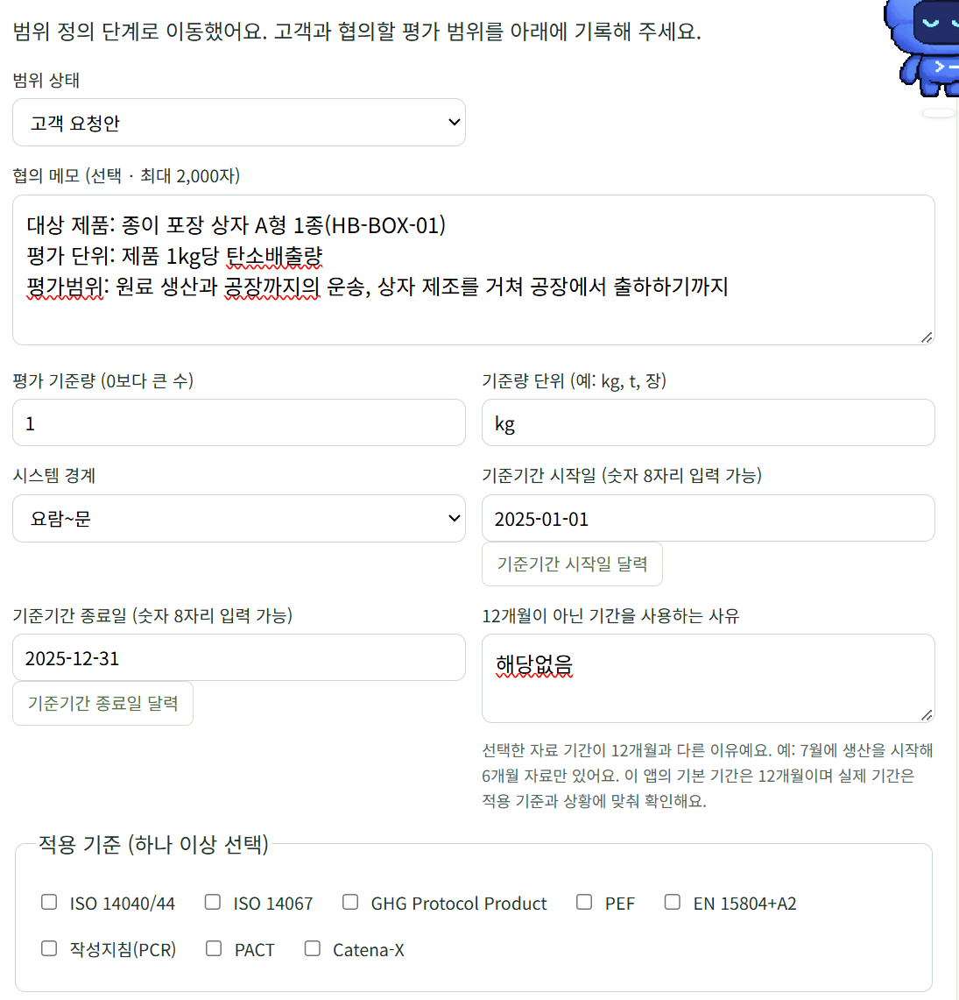

그림 4는 사용자가 실제로 대화에 첨부한 과거 화면이다. 일부 항목은 현재 값과 다르다. 과거 화면을 현재 값으로 수정하지 않고 그대로 보관했다.

### 항목별 입력과 판단 이유

| 항목 | 이번 실습의 값 | 왜 이렇게 정리했는가 | 확인할 점 |
| --- | --- | --- | --- |
| 범위 상태 | 고객 요청안 | 고객이 원하는 내용을 옮기는 단계였기 때문 | 내용이 채워져 있어도 최종 합의를 뜻하지 않음 |
| 대상 제품 | A형 1종 / HB-BOX-01 | 어떤 모델과 규격을 평가하는지 구분하기 위해 | 현재 세부 모델·코드는 메모에 있고, 별도 보충 정보에는 빠진 항목이 있음 |
| 대상 사업장 | 제1공장 | 어느 공장의 생산 기록을 사용할지 정하기 위해 | 다른 공장 자료가 섞이지 않게 이후 자료 기간·범위를 확인 |
| 평가 기준량 | 1 | 평가 결과를 어떤 제품량에 맞춰 정리할지 정하기 위해 | 숫자 1은 제품량이며 배출량 결과가 아님 |
| 기준량 단위 | kg | 제품 1kg이라는 기준을 표현하기 위해 | 완제품 한 장과 1kg은 다른 기준이므로 단위가 필요 |
| 시스템 경계 | 요람~문 | 원료 생산부터 공장 출하까지를 대상으로 요청했기 때문 | 고객과 포함·제외 과정이 같은 뜻으로 이해됐는지 확인 |
| 기준기간 | 2025-01-01 ~ 2025-12-31 | 2025년 한 해의 자료를 사용하는 상황이기 때문 | 자료가 같은 기간과 대상 제품·공장을 다루는지 확인 |
| 12개월이 아닌 사유 | 빈칸 | 이번 입력은 12개월이어서 예외 사유가 필요하지 않음 | 초기에 적었던 해당없음은 필수 내용이 아님 |
| 적용 기준 | 현재 ISO 14040/44 선택 | 사용자가 설명을 보고 선택한 현재 저장 상태 | 고객 요구/제출 목적에 맞는 최종 기준 합의는 남아 있음 |

### 기준량과 결과를 구분한 이유

초기 메모의 제품 1kg당 탄소배출량이라는 표현에는 두 가지 뜻이 함께 들어 있었다. 이를 현재 메모에서는 **평가 기준량: 제품 1kg**, **요청 결과: 제품 1kg당 온실가스 배출량**으로 나눴다. 무엇을 기준으로 삼는지와 무엇을 알아내려는지를 나누면 이후 자료와 결과를 읽기 쉽다.

### 포함과 제외를 함께 적은 이유

이번 요청에서 포함한 과정은 원료 생산 → 공장까지 원료 운송 → 상자 제조 → 공장 출하다. 출하 후 배송·사용·폐기는 이번 범위에서 제외한다고 기록했다. 이 제외는 해당 과정의 환경영향이 없다는 뜻이 아니라, 이번 실습에서 정한 평가 대상 과정의 끝을 설명하는 것이다.

### 현재 협의 메모 원문

다음은 이번 기록 작업에서 브라우저 입력칸을 읽어 보관한 내용이다. 문장을 새로 다듬지 않고 줄바꿈을 유지했다.

```text
대상 제품: 종이 포장 상자 A형 1종(HB-BOX-01)
대상 사업장: 제1공장
평가 기준량: 제품 1kg
요청 결과: 제품 1kg당 온실가스 배출량

평가 범위: 원료 생산 → 공장까지 원료 운송 → 상자 제조 → 공장 출하
이번 요청에서 제외: 출하 후 배송·사용·폐기
자료 기간: 2025-01-01~2025-12-31

자료 취합 담당: 김민지
적용 기준 및 거래처 지정 양식: 추가 확인 필요
```

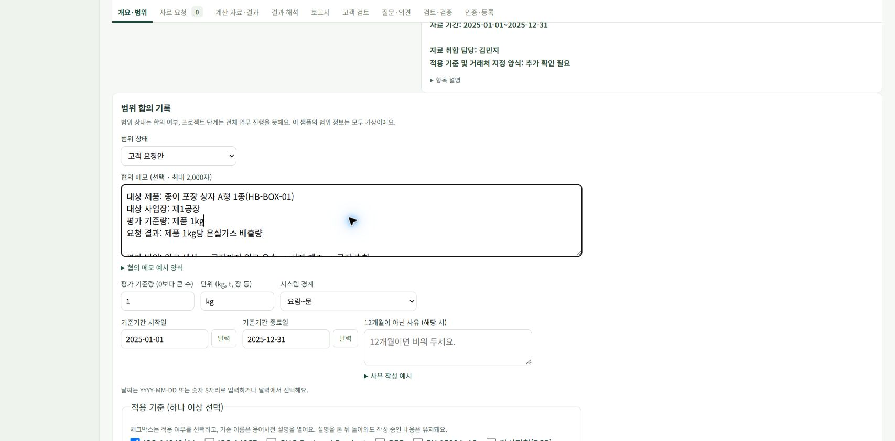

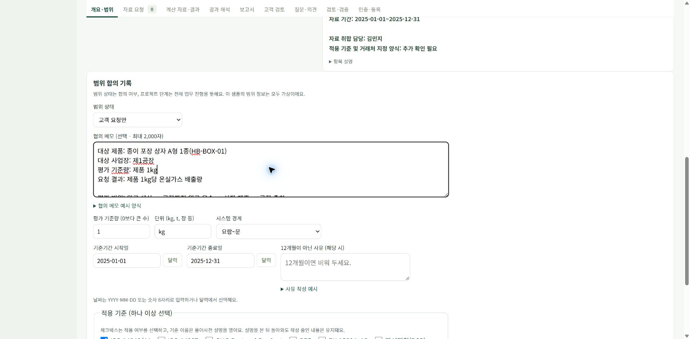

## 6. R04 — 적용 기준을 이해하고 용어사전을 사용함

**진행 근거: 설명 대화 + 과거 PEF 캡처 + 현재 ISO 설명 화면.**

사용자는 적용 기준 이름이 낯설어 각각의 뜻과 용어사전 연결을 요청했다. 기존에 6개 설명이 있었고, GHG Protocol Product·PEF를 추가해 적용 기준 8개를 모두 연결했다. 이번 실습에서 설명한 뜻을 아래에 요약한다. 실제 프로젝트의 적용 문서·버전·요건은 별도로 확인해야 한다.

| 기준 / 방법 | 실습에서 이해한 뜻 | 원문 |
| --- | --- | --- |
| ISO 14040/44 | LCA의 큰 틀과 구체적인 수행 요건을 다룸 | [ISO 14040](https://www.iso.org/standard/37456.html), [ISO 14044](https://www.iso.org/standard/38498.html) |
| ISO 14067 | 제품 탄소발자국을 정량화하고 보고하는 원칙·요건·지침 | [ISO](https://www.iso.org/standard/71206.html) |
| GHG Protocol Product | 제품 전 과정 온실가스의 산정·보고 기준 | [GHG Protocol](https://ghgprotocol.org/product-standard) |
| PEF | 제품의 여러 환경영향을 평가하는 유럽위원회의 LCA 기반 방법 | [유럽위원회](https://green-forum.ec.europa.eu/green-business/environmental-footprint-methods/about-ef-methods_en) |
| EN 15804+A2 | 건설제품 EPD의 공통 규칙 | [BSI](https://knowledge.bsigroup.com/products/sustainability-of-construction-works-environmental-product-declarations-core-rules-for-the-product-category-of-construction-products-2) |
| 작성지침(PCR) | 제품군별로 더 구체적인 LCA·EPD 작성 조건을 정함 | [EPD International](https://www.environdec.com/services/what-is-pcr) |
| PACT | 제품 탄소발자국의 일관된 계산과 정보 교환을 위한 방법·규칙 | [PACT](https://www.carbon-transparency.org/pact-methodology) |
| Catena-X | 자동차 산업 데이터 생태계와 PCF 관련 규칙 | [Catena-X](https://catenax-ev.github.io/docs/rulebooks/overview) |

위 목록은 모두 같은 종류의 국제표준이라는 뜻이 아니다. 국제표준·평가 방법·제품군별 지침·공급망 정보 교환 규칙이 함께 들어 있다. 전부 체크하는 목록으로 이해하지 않고 고객 요구와 목적에 맞춰 검토한다.

제품 탄소정보를 다루는 이번 실습에서 ISO 14067은 검토할 후보로 설명했다. 현재 앱에 저장된 선택은 ISO 14040/44이며, 어시스턴트가 ISO 14067을 자동 선택하지 않았다. 후보 설명을 적용 확정으로 기록하지 않는다.

### 화면 조작의 의미

- 체크박스: 이 프로젝트의 적용 여부를 선택한다.
- 기준 이름: 용어사전의 관련 설명을 연다.
- 작성하던 프로젝트로 돌아가기: 기존 범위 입력 화면으로 복귀한다.

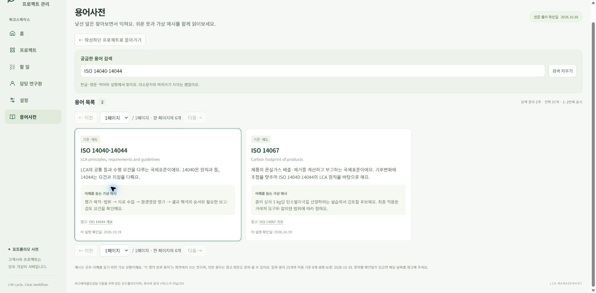

그림 7은 이번 기록 시점에 ISO 14040/44 이름을 눌러 연 설명이다. 검색 결과에는 관련 용어가 함께 보일 수 있다. 설명을 읽고 프로젝트로 돌아왔으며 체크값이나 메모를 저장하지 않았다.

과거 기능 확인 때 찍은 PEF 화면은 `images/h03-pef-glossary.jpg`에 별도로 보관했다. 이는 기능 확인용 화면이며 PEF를 이 프로젝트에 적용했다는 근거가 아니다.

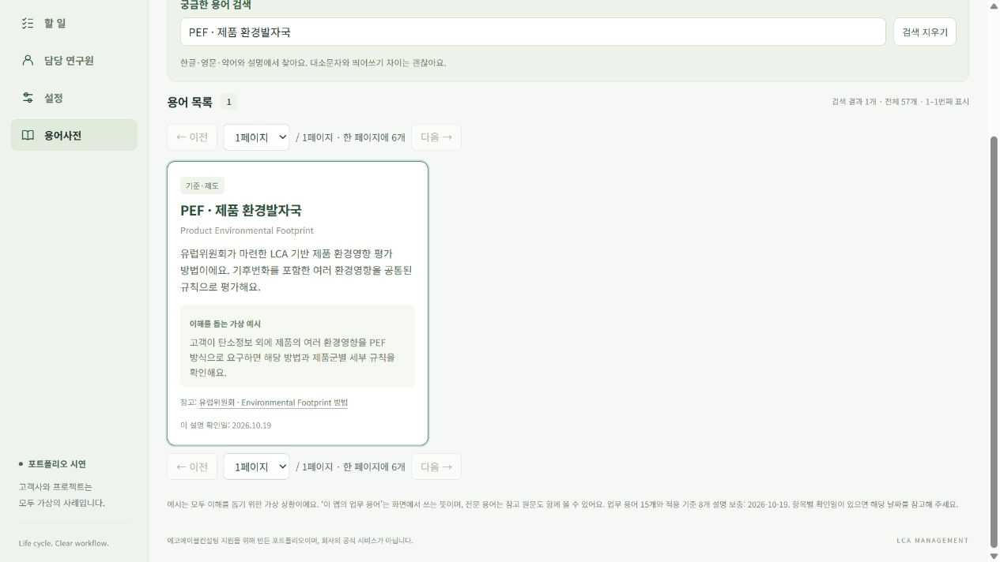

## 7. R05 — 쓰면서 발견한 불편을 개선함

**진행 근거: 사용자 요청·첨부 화면 + 현재 UI 확인.**

### 불편 1: 짧은 값에 비해 입력칸이 너무 넓음

사용자는 기준량·단위·경계·기간 입력칸이 필요보다 가로로 길어 읽기 불편하다고 피드백했다. WEB-068에서 범위 폼의 최대 폭을 줄이고 짧은 입력을 필요한 폭으로 모았다. 날짜 입력과 달력 버튼도 나란히 배치했다. 긴 설명은 접어서 볼 수 있게 정리했다.

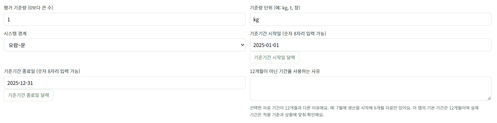

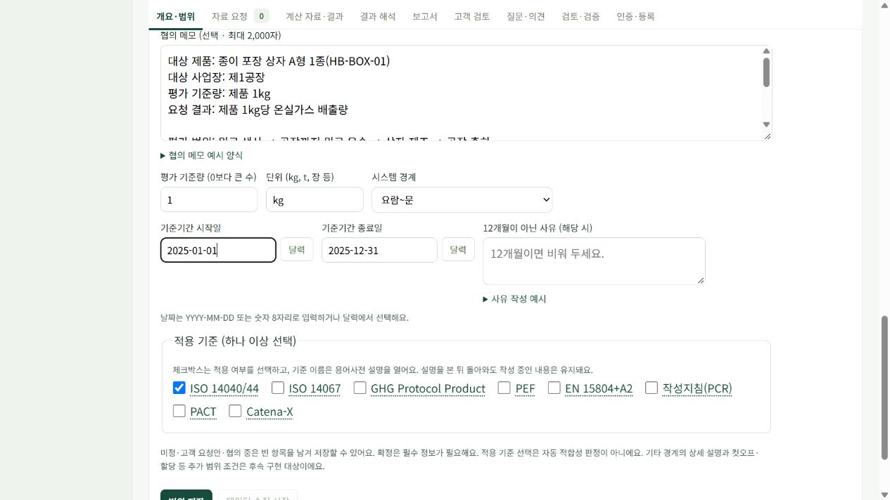

두 그림의 촬영 해상도는 다르다. 같은 해상도에서 측정한 비교 자료가 아니라, 사용성 피드백과 배치 변경의 근거로 보관한다.

### 불편 2: 협의 메모에 무엇을 적을지 예시가 필요함

대상 제품·기준량·범위·기간·적용 기준·미정 사항을 정리하는 여러 줄 안내와 접힌 예시 양식을 추가했다. 빈 메모에는 항목을 넣을 수 있지만 기존 메모가 있으면 버튼을 비활성화하여 내용을 유지한다.

이 양식은 메모를 쓰기 쉽게 하는 보조 수단이다. 메모를 적는 것만으로 다른 입력칸이 자동으로 채워지거나 저장되지는 않는다. 사용자가 제안한 이메일/짧은 메모 기반 AI 입력 보조는 추후 계획이다.

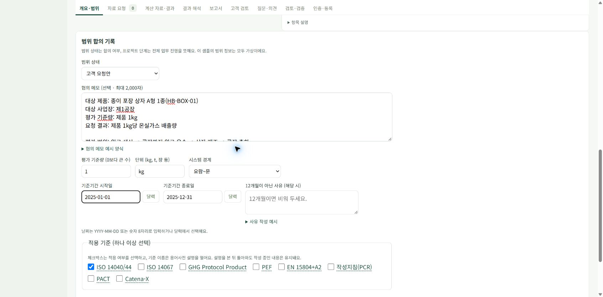

### 배운 점

실제 사용 과정에서 용어를 모르는 문제와 화면 배치가 불편한 문제가 함께 드러났다. 설명 연결·예시·짧은 입력 배치는 사용자가 스스로 입력 의미를 이해하고 필요한 정보를 찾는 데 도움을 주려는 개선이다.

## 8. R06 — 다른 노트북과 공개 사이트로 기록을 옮김

**진행 근거: 실제 다운로드 파일·복원 미리보기·복원 완료 안내·새로고침 후 상세 화면.**

### 왜 이전 기록이 보이지 않았는가

현재 앱은 각 주소와 브라우저의 저장 공간에 기록한다. GitHub에는 코드와 문서를 보관하고, 사용자가 입력한 프로젝트·메모는 해당 브라우저에 저장된다. 따라서 로컬 주소에서 입력한 기록이 공개 사이트에 자동으로 나타나지 않는다. 여러 기기 자동 동기화용 서버 DB는 연결하지 않았다.

이번 실습에서는 기능 범위를 늘리기보다 백업 파일을 내려받고 다른 접속 환경에서 복원하는 방식으로 이동했다. 방문자가 공개 사이트에서 작성한 기록도 각자의 브라우저에 저장된다.

### 실제로 사용한 백업

| 파일 | 역할 | 확인 |
| --- | --- | --- |
| LCA-백업-2026-10-20-150501.json | 이전 로컬 실습을 옮길 원본 | 파일 존재·2,432바이트, 프로젝트 8개·연구원 4명·담당 변경 1건 |
| LCA-백업-2026-10-20-141936.json | 복원 전 Chrome 공개 사이트의 기록 보관 | 실제 다운로드 파일 존재·884바이트 확인 |
| evidence/restore-source-backup.json | 위 원본의 기록 폴더 내 사본 | 앱 복원용 JSON |
| evidence/chrome-before-restore-backup.json | 복원 전 Chrome 기록의 사본 | 필요하면 당시 상태로 되돌릴 때 쓸 수 있음 |

파일명 끝 숫자로 시각이나 파일의 앞뒤 순서를 새로 추정하지 않는다. 백업 미리보기에 표시된 원본 백업 시점은 **2026-10-20 오전 12:05, 한국 시간**이었다.

### 실제 진행 순서와 이유

1. 사용자가 Chrome에 연 공개 사이트를 확인했다. 다른 주소나 다른 브라우저에 복원하지 않기 위해 대상 탭을 먼저 식별했다.
2. 현재 공개 사이트의 기록을 먼저 내려받았다. 복원은 두 기록을 합치는 작업이 아니라 전체 교체이므로 복원 전 상태를 따로 보관했다.
3. Chrome 연결과 파일 선택 권한을 설정했다. 처음에는 연결 목록에 Chrome이 없었고, 연결 후에는 파일 URL 접근 허용이 필요했다. 사용자가 설정한 뒤 파일 선택이 가능해졌다.
4. 이전 백업 파일을 읽었다. 미리보기에서 프로젝트 8개·연구원 4명·한빛 포장 연습·담당 변경 1건을 확인했다.
5. 사용자의 백업 가져오기 요청에 따라 전체 교체 확인과 복원을 진행했다.
6. 앱의 복원 완료 안내가 나온 뒤 새로고침했다.
7. 프로젝트 목록에서 LCA-2026-009가 다시 나타나고 담당 박기나·범위 정의·고객 요청안·기존 메모가 유지되는 것을 확인했다.

공개 주소: https://lca-project-manager-kina2002.flowy-pony-5289.chatgpt.site/

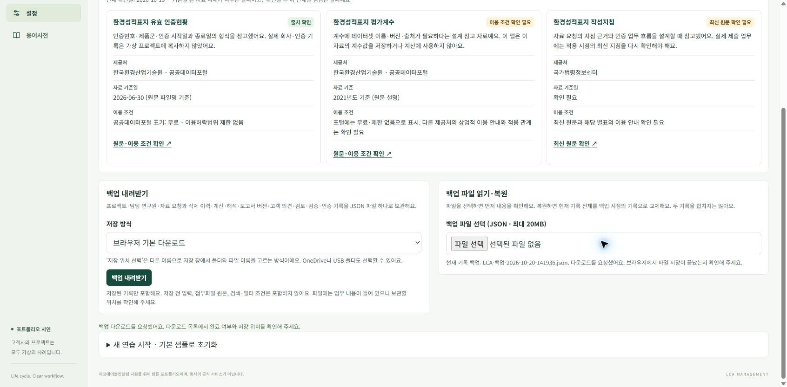

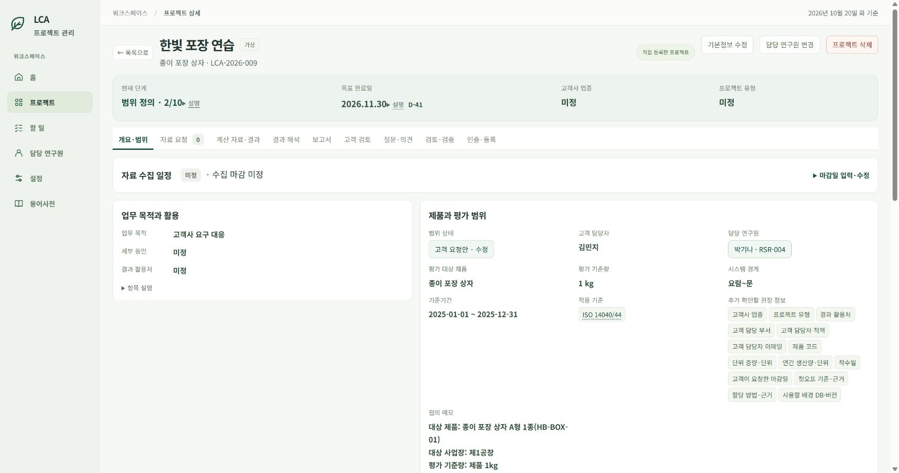

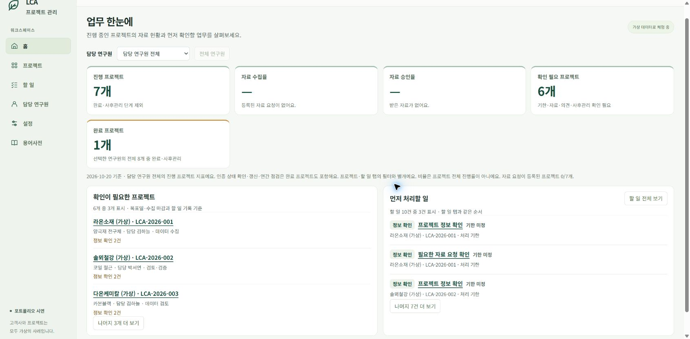

### 이번에 확인한 범위

파일을 읽기만 한 상태와 실제 복원 완료 상태를 구분했다. 이번에는 실제 복원과 새로고침 후 표시까지 확인했다. 다른 브라우저나 노트북까지 자동으로 동기화되는 기능을 만든 것은 아니다. 복원 후 새로 바꾸는 기록도 현재 Chrome의 공개 주소 저장 공간에 남는다.

## 9. R07 — 추가 고객 회신을 받고 협의 내용을 갱신할 준비

**진행 근거: 이번 대화의 가상 회신 원문 + 현재 화면 대조. 상태는 안내 / 미완료.**

다음은 어시스턴트가 고객사 역할로 전달한 추가 회신이다. 실제 외부 메일을 발송하거나 수신한 기록이 아니다.

> 박기나 연구원님, 안녕하세요. 한빛포장 김민지입니다.
>
> 거래처에 확인해보니 지정된 평가 기준이나 제출 양식은 없다고 합니다. 종이 상자 1kg당 탄소배출량과 산정 근거를 요청했습니다.
>
> 원료 생산부터 공장 출하까지 평가하고, 출하 이후 운송·사용·폐기는 제외하는 것으로 확인했습니다.
>
> 적용할 평가 기준을 검토해서 제안 부탁드립니다.

### 회신을 어떻게 해석하는가

| 회신 내용 | 업무에서 읽을 뜻 | 다음 행동 |
| --- | --- | --- |
| 지정 기준·양식 없음 | 거래처가 특정 문서를 지정하지 않았다는 가상 답변 | 연구원이 목적에 맞는 기준을 검토해 제안 |
| 제품 1kg당 결과와 근거 요청 | 결과 수치와 산정 근거를 함께 원함 | 기준량과 요청 결과를 구분해 기록 |
| 원료부터 공장 출하까지 | 포함·제외 과정에 대한 고객 답변 | 기존 경계 메모와 대조하여 갱신 |
| 기준 제안 부탁 | 최종 적용 기준의 합의는 아직 남음 | 범위 상태를 협의 중으로 관리 |

### 사용자에게 안내한 메모 추가안

```text
추가 협의:
- 거래처가 지정한 평가 기준·제출 양식은 없음.
- 제품 1kg당 탄소배출량과 산정 근거를 요청함.
- 출하 이후 운송·사용·폐기는 이번 평가에서 제외하기로 확인함.
- 적용 기준은 연구원이 검토·제안한 뒤 고객과 최종 합의 예정.
```

### 왜 아직 확정으로 두지 않는가

평가할 제품·양·기간·과정이 정리되어 있어도, 이번 역할극에서는 어떤 기준으로 평가할지 고객과 합의하는 일이 남아 있다. 그래서 기존 메모에 추가 회신을 기록하고 범위 상태를 협의 중으로 바꿔 저장하도록 안내했다.

현재 화면에서는 **고객 요청안**이 선택되어 있고 위 추가 협의 문구는 메모에 없다. 따라서 사용자가 이를 저장했다고 기록하지 않는다. 캡처를 위해 상태를 바꾸거나 범위 저장을 대신 누르지 않았다.

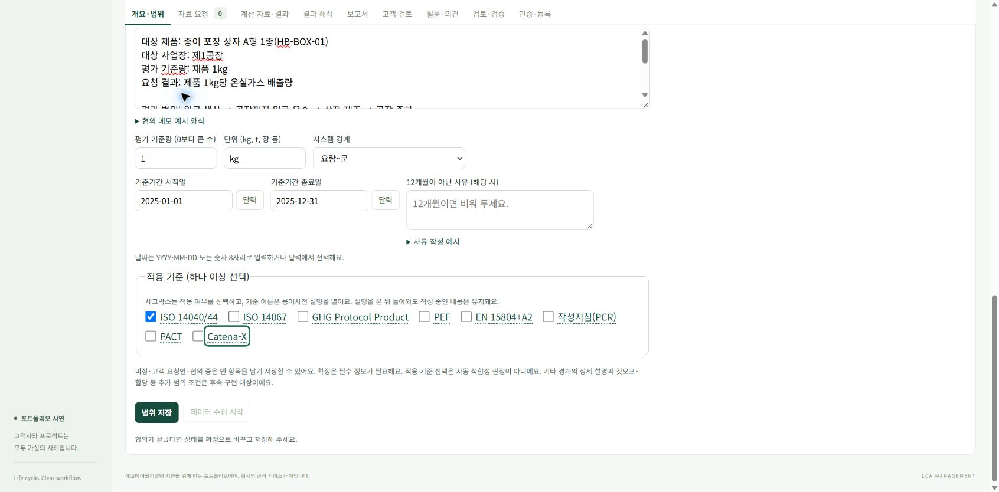

## 10. 실습에서 구분해서 기억할 것

### 프로젝트 단계와 범위 상태

범위 정의 2단계는 업무의 어느 부분을 진행하는지 나타낸다. 고객 요청안·협의 중·확정은 평가 범위를 고객과 어느 정도 합의했는지 나타낸다. 협의 중으로 저장한다고 자료 수집 단계로 자동 이동하지 않는다.

### 메모와 구조화된 입력칸

메모는 제품·사업장·협의 경위 등 맥락을 남긴다. 기준량·경계·기간·적용 기준은 별도의 입력칸에도 기록한다. 메모에 쓴 제품 코드가 모든 보충 정보 칸에 자동 반영되는 것은 아니므로, 화면에서 권장 누락으로 보일 수 있다.

### 목표 완료일과 자료 기한

2026-11-30은 이번 프로젝트의 목표 완료일이다. 자료 수집 마감일과 개별 자료 요청 기한은 따로 정할 항목이다. 현재 자료 요청이 없으므로 자료 수집·승인이 끝났다고 설명할 수 없다.

### 입력과 저장

화면에 입력된 내용, 저장 후 요약에 반영된 내용, 백업에 포함된 내용을 구분한다. 백업은 저장된 기록을 담고, 저장 전 입력과 검색 조건은 별도다. 이번 기록에서는 입력값과 화면 근거를 읽어 사본으로 남겼다.

### 실제 성과로 설명할 수 있는 범위

이 실습에서 말할 수 있는 경험은 고객 요청을 항목으로 나누어 기록하고, 합의 상태를 구분하고, 사용 중 발견한 불편을 개선하고, 브라우저 간 기록을 백업으로 이동해 본 것이다. 탄소발자국 산정·외부 검증·보고서 발급을 실제로 완료했다는 설명은 현재 진행과 맞지 않는다.

## 11. 다음에 이어갈 체크리스트

- [ ] 추가 고객 회신을 기존 협의 메모에 반영하기.
- [ ] 범위 상태를 협의 중으로 바꾸고 범위 저장하기.
- [ ] 저장 결과의 요약·현재 단계·체크된 기준을 다시 확인하고 캡처하기.
- [ ] 연구원 입장에서 적용 기준 제안 내용을 정리하기.
- [ ] 고객 역할의 답변으로 최종 기준·범위를 합의하기.
- [ ] 합의 후 사용자가 범위를 확정·저장하기.
- [ ] 준비 조건을 확인하고 데이터 수집 시작하기.
- [ ] 고객에게 요청할 자료와 요청 이유를 항목별로 정리하기.

현재 단계에서 위 항목을 미리 완료 처리하지 않는다. 사용자가 직접 진행한 뒤 실제 화면과 저장 안내를 확인해 다음 기록을 추가한다.

## 12. 앞으로 기록을 추가하는 방식

실습 사건 하나마다 `R08`, `R09`처럼 번호를 이어 붙인다. 가상 메일 → 요청 해석 → 입력/조작 → 이유 → 화면 근거 → 결과 → 다음 할 일을 같은 순서로 기록한다. 원문과 요약, 실제 저장과 안내, 현재 캡처와 과거 캡처를 구분한다.

이미지는 새 번호와 파일명으로 추가하여 이전 증거를 덮어쓰지 않는다. 입력 전후를 모두 확보할 수 있으면 두 장을 보관하고, 한쪽만 있으면 그 한계를 적는다. 어떤 값을 왜 바꿨는지와 아직 모르는 내용도 함께 기록한다. 자세한 빈 양식은 `기록양식.md`를 사용한다.

## 13. PDF로 정리할 때 사용할 구성

1. 표지: 프로젝트·실습 기간·역할·학습 목적.
2. 사건 흐름: 고객 요청→프로젝트 등록→범위 협의→담당 변경→자료 이동→후속 협의.
3. 핵심 입력 설명: 기준량/단위/경계/기간/기준과 선택 이유.
4. 실제 화면: 그림 번호·캡션·진행 시점·확인 사실을 함께 배치.
5. 배운 점: 실습에서 이해한 내용과 아직 남은 일.
6. 부록: 메일 원문/요약 구분, 화면 목록, 참고 원문, 확인 한계.

현재 파일은 PDF 제작을 위한 누적 원본이다. 아직 PDF를 생성하지 않았다. PDF 제작 시 긴 화면을 페이지에 무작정 축소하지 말고, 읽을 수 있는 부분 캡처를 본문에 배치한다. 현재 이미지의 상대경로와 캡션을 유지하고, 표준 적합성이나 실제 업무 완료에 관한 표현은 최종 진행 상태에 맞게 점검한다.

## 14. 근거 파일과 확인 한계

- 현재 화면 텍스트: `evidence/2026-10-20-current-detail.txt`.
- 현재 범위 입력값: `evidence/2026-10-20-scope-fields.json`.
- 실제 담당자 변경 이력 화면 텍스트: `evidence/researcher-history.txt`.
- 새 캡처의 UTC 촬영 시각·캡션: `evidence/screenshots.json`.
- 과거 이미지의 원래 출처·시각 미상 표시: `evidence/historical-screenshots.json`.
- 전체 화면 파일 목록과 설명: `화면목록.md`.

새로 캡처한 화면은 취침 전 백업 화면을 포함해 10장이고 과거 보관/사용자 첨부 화면은 6장이다. 긴 전체 페이지 캡처는 도구 시간 제한으로 생성하지 못해 읽을 수 있는 부분 화면으로 보관했다. 최초 등록/초기 배정의 클릭 순간, 초기 메일 발송 순간, 이번 추가 회신 반영·협의 중 저장의 완료 화면은 없다. 이 문서를 실제 업무 전 과정의 동작 시험 완료로 사용하지 않는다.

## 15. 취침 전 GitHub 인수인계 추가 기록

사용자가 다음 노트북에서 백업 파일을 잊지 않고 받을 수 있도록 GitHub에 함께 올려 달라고 요청했다. 저장소가 비공개임을 확인하고 최신 main의 handoff 폴더에 이 가상 실습 원본·화면·양식·근거와 최신 백업을 함께 보관한다. 공개 데모 배포 파일은 변경하지 않는다.

Chrome 공개 사이트의 백업 내려받기로 **LCA-백업-2026-10-20-144633.json**을 새로 만들었다. 실제 다운로드 파일의 크기 2,432바이트와 JSON 형식을 확인하고 원문을 **handoff/latest-backup.json**에 복사했다. 백업 직전 화면의 범위 입력 16개와 대조하여 차이가 없음을 확인했다. 추가 회신 메모·협의 중 저장은 여전히 미완료이며, 백업을 위해 대신 저장하지 않았다.

다음 노트북에서는 최신 main을 받은 뒤 handoff/README.md의 현재 기록 선백업→latest-backup.json 선택/미리보기→전체 교체 확인→복원/새로고침을 따른다. Git에서 파일을 받은 것만으로 브라우저 기록이 자동 적용되는 것은 아니다. 최신 백업의 원본 이름·해시·상태는 handoff/manifest.json에 남긴다. 이번 인수인계는 실습 업무 R08을 완료한 것으로 세지 않는다.

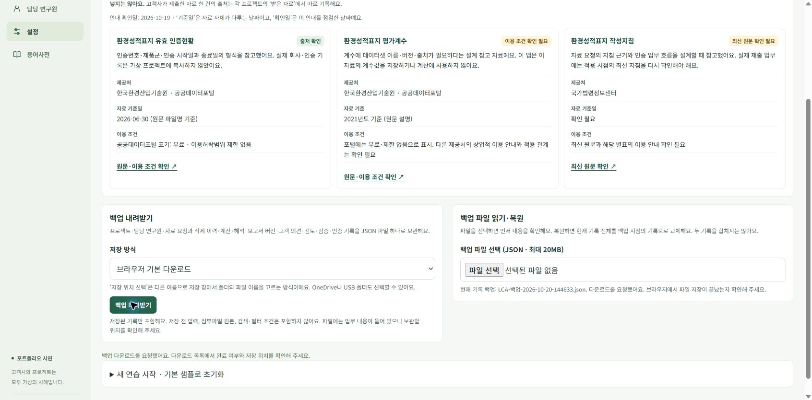
